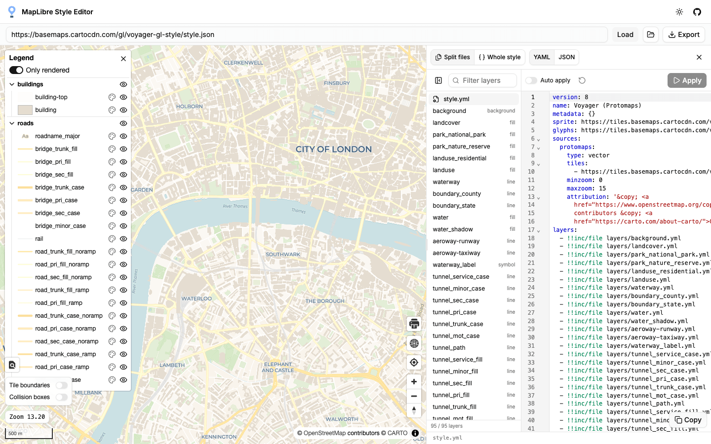
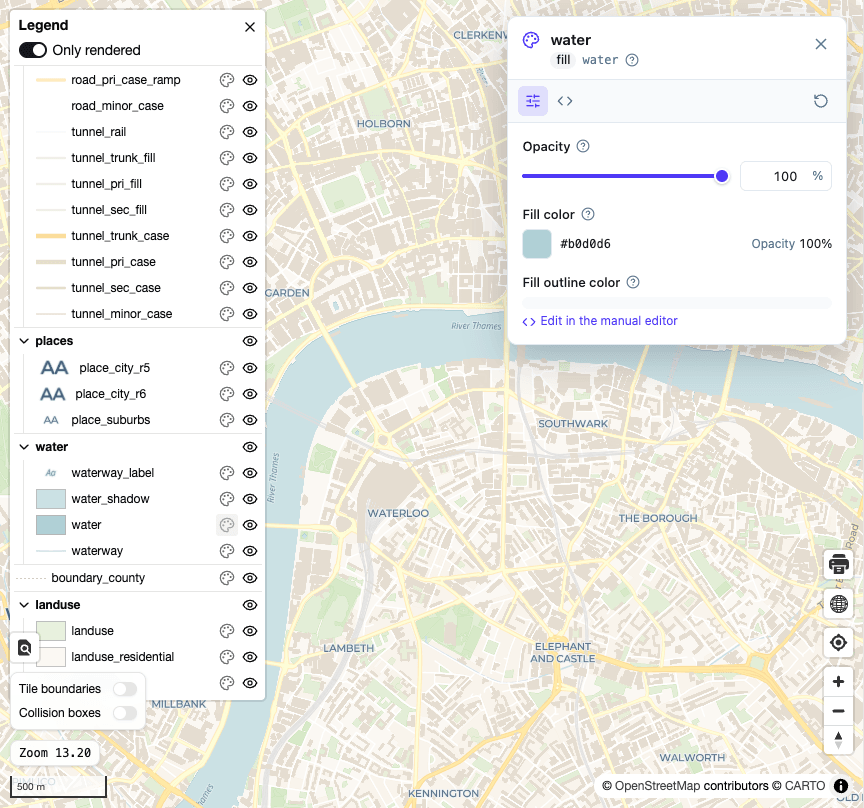
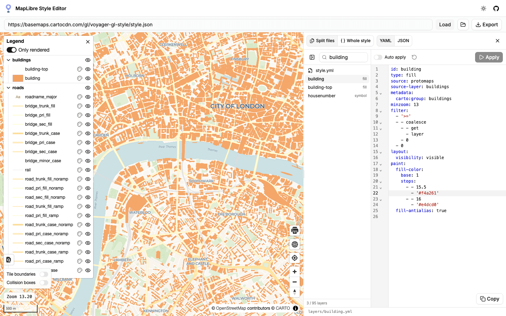
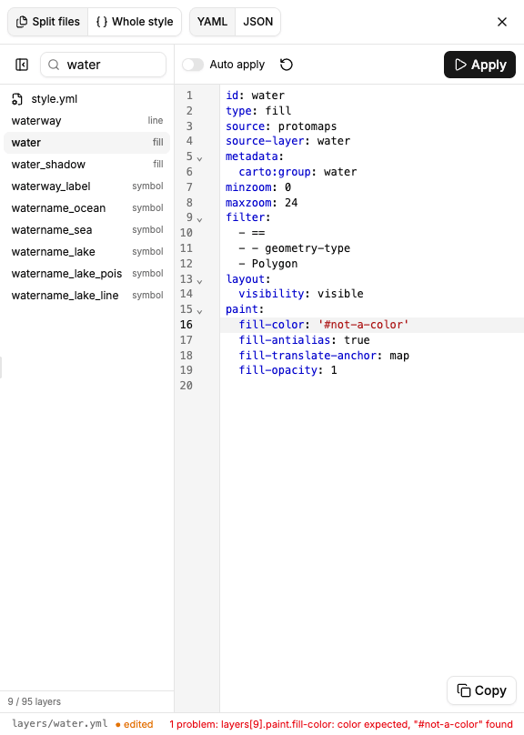
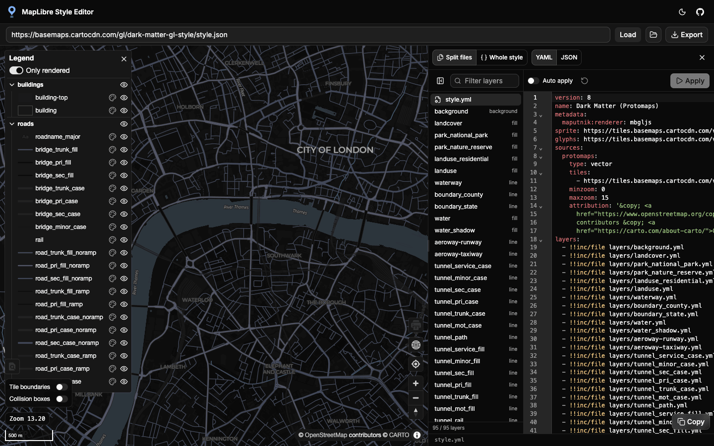
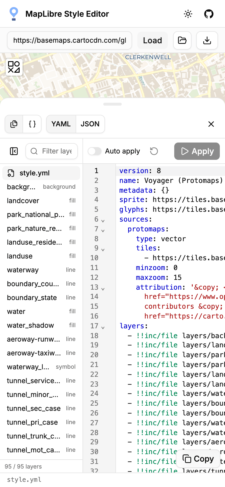

# MapLibre Style Editor

**Load a [MapLibre](https://maplibre.org/) style, edit it on the map or as YAML / JSON, and export it — all in the browser.**

[](./LICENSE)
[](https://maplibre.org/maplibre-gl-js/docs/)
[](#compatible-with-unvt-charites)

<!-- Live demo: https://maplibre-style-editor.<subdomain>.workers.dev -->



## Highlights

- 🗺️ **Edit visually** — change colors, opacity and more from the legend, and see the map update.
- 📝 **Edit as code** — the style as YAML or JSON, one file per layer or as a whole, kept in sync with the map.
- ✅ **Validated as you type** — errors against the [MapLibre style specification](https://maplibre.org/maplibre-style-spec/) are shown before they reach the map.
- 🧩 **[UNVT Charites](https://github.com/unvt/charites) compatible** — `style.yml` + `layers/*.yml` with `!!inc/file` and `$variables`.
- 📦 **Export** as JSON, a single YAML file, or a zip of split YAML files.
- 🌗 **Light / dark theme** and a mobile layout.

## Features

### Load a style from anywhere

- A **sample style**: CARTO Voyager, Positron, Dark Matter and [MapLibre World](https://github.com/maplibre/demotiles).
- A **URL** of a style as JSON or YAML, or `?style=<url>` in the address of the app.
- A **file** opened or dropped on the map: JSON, YAML, or a **zip of split YAML files** (e.g. a Charites project).
- [PMTiles](https://protomaps.com/docs/pmtiles) sources (`pmtiles://`) are supported.

### Edit on the map

The palette button of a layer in the legend opens the style editor of [maplibre-gl-legend](https://github.com/watergis/maplibre-gl-legend). Layers are grouped by their source layer, and changes appear on the map and in the code at once.



### Edit as code

The panel on the right shows the style as text and follows the map in real time.

- **Split files**: `style.yml` (the root of the style) and one `layers/<id>.yml` per layer, with a filterable file list.
- **Whole style**: the style as one file.
- **YAML** or **JSON**, switchable at any time.
- Apply with **Apply**, <kbd>⌘S</kbd> / <kbd>Ctrl+S</kbd>, or turn on **Auto apply**.



Syntax errors are marked where they are, and errors against the style specification are listed at the bottom. Edits with errors are not applied, so the map never breaks.

<p align="center">
  
</p>

### Export

| Export menu              | Output                                         |
| ------------------------ | ---------------------------------------------- |
| Style JSON               | `style.json`, pretty-printed                   |
| Style JSON (minified)    | `style.json`, minified                         |
| Style YAML (single file) | the whole style as one YAML file               |
| Split YAML files (zip)   | `style.yml` + `layers/*.yml` (Charites layout) |
| Copy style JSON          | the style JSON to the clipboard                |

The print button on the map exports the map itself as an image or PDF ([maplibre-gl-export](https://github.com/watergis/maplibre-gl-export)).

### Map tools

Globe view, geolocation, scale, zoom level, **tile boundaries** and **collision boxes** for debugging labels, and an **inspect** mode ([maplibre-gl-inspect](https://github.com/maplibre/maplibre-gl-inspect)) to see the features of the vector tiles.

### Dark theme and mobile

Light, dark or system theme — the map controls, the legend and the editor follow it. On narrow screens the editor opens as a drawer from the bottom.

<p align="center">
  
  &nbsp;
  
</p>

## Compatible with UNVT Charites

[Charites](https://github.com/unvt/charites) is a command line tool of the [UNVT](https://github.com/unvt) community to write MapLibre styles as YAML and build them into JSON. The split YAML files of this editor use the same layout, so you can move between the two freely:

- `style.yml` holds the root of the style and refers to `layers/<id>.yml` with the `!!inc/file` tag.
- Variables (`$name`) defined at the root of `style.yml` can be used anywhere in the style.

**Charites → editor**: zip a Charites project (`style.yml` and `layers/`, at the root of the zip or in one folder) and drop it on the map.

```bash
charites convert style.json style.yml   # or an existing Charites project
zip -r my-style.zip style.yml layers
```

**Editor → Charites**: export **Split YAML files (zip)**, unzip it, and use Charites as usual.

```bash
unzip my-style.zip
charites build style.yml style.json
charites serve style.yml
```

> [!NOTE]
> Variables are resolved when the files are loaded, so they are not kept in the style being edited, and an export writes the resolved values instead of `$name`.

## Usage

### Loading a style

| How                       | What                                                                                  |
| ------------------------- | ------------------------------------------------------------------------------------- |
| Sample styles             | Click the URL box and choose a sample style from the list under it.                   |
| URL                       | Enter the URL of a style (JSON or YAML) and press _Load_. The server must allow CORS. |
| File                      | Open a file with the folder button, or drop it on the map.                            |
| `?style=<url>` in the URL | Loads the style at `<url>` on start, e.g. `/?style=https://example.com/style.json`.   |

Files can be:

- a style as JSON (`.json`)
- a style as one YAML file (`.yml`, `.yaml`)
- a zip of split YAML files (`.zip`): `style.yml` and `layers/*.yml`, at the root of the zip or in one folder

### Editing as text

The editor shows the selected document; edit it, then press **Apply** or <kbd>⌘S</kbd> / <kbd>Ctrl+S</kbd>. With **Auto apply** on, the edits are applied after a short pause in typing.

- Changes made on the map (e.g. with the style editor of the legend) replace the text at once. If the text has edits not applied yet, they are kept and a banner offers to load the latest style instead.
- Loading another style or switching the document asks before discarding edits not applied yet.

### Split YAML files

```yaml
# style.yml
$water: '#b0d0d6'
version: 8
name: Voyager
sources:
  protomaps:
    type: vector
    url: https://example.com/tiles.json
layers:
  - !!inc/file layers/background.yml
  - !!inc/file layers/water.yml
```

```yaml
# layers/water.yml
id: water
type: fill
source: protomaps
source-layer: water
paint:
  fill-color: $water
```

- Editing the list of `!!inc/file` in `style.yml` (as YAML) reorders or removes layers.
- A value `$name` is replaced by the value of the variable `$name` defined at the root of `style.yml`.

## Development

Requires Node.js 22+ and pnpm.

```bash
pnpm install
pnpm dev        # http://localhost:5173
pnpm test       # unit tests
pnpm check      # type check
pnpm lint
pnpm format
```

Built with [SvelteKit](https://svelte.dev/docs/kit), [shadcn-svelte](https://shadcn-svelte.com/), [Tailwind CSS](https://tailwindcss.com/), [MapLibre GL JS](https://maplibre.org/maplibre-gl-js/docs/) and [CodeMirror](https://codemirror.net/).

### Deploying to Cloudflare Workers

The app is built with `@sveltejs/adapter-cloudflare` and deployed with [Wrangler](https://developers.cloudflare.com/workers/wrangler/) (configuration: [`wrangler.jsonc`](./wrangler.jsonc)).

```bash
pnpm build
pnpm preview    # runs the built app on the Workers runtime locally
pnpm deploy     # builds and deploys
```

`worker-configuration.d.ts` is generated by `wrangler types` (on install, build and check) and is not committed.

## License

[MIT](./LICENSE)
